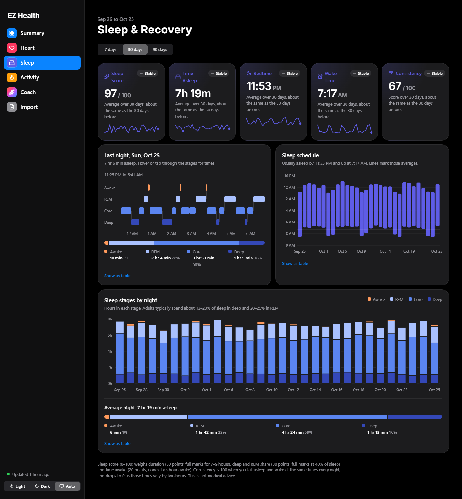
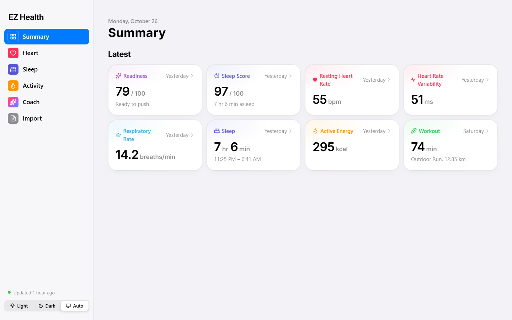
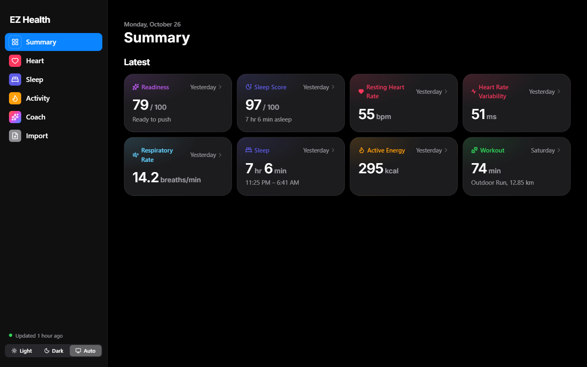
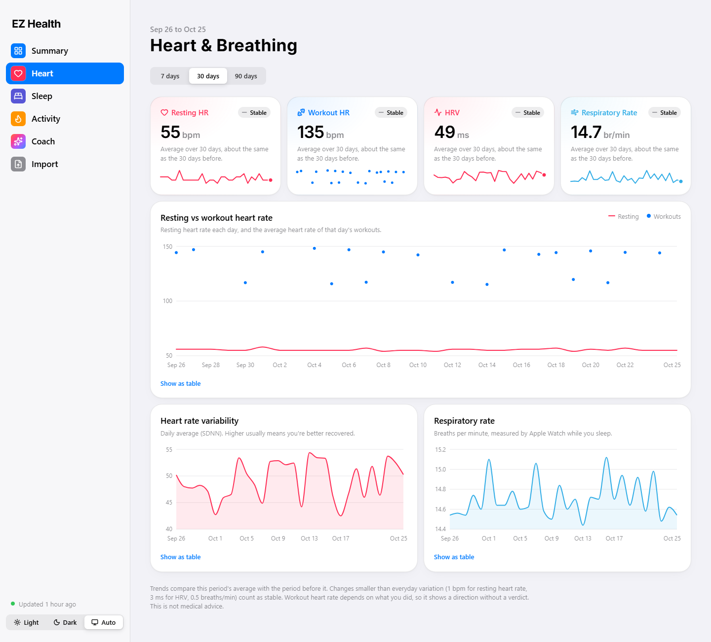
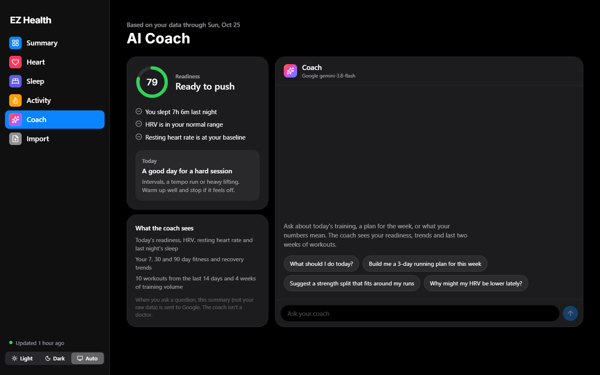
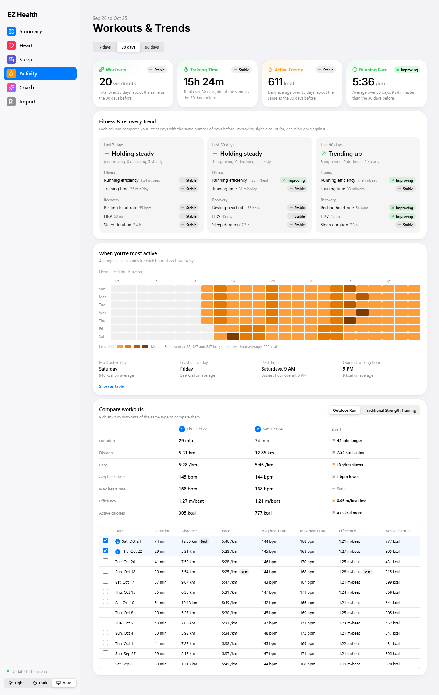
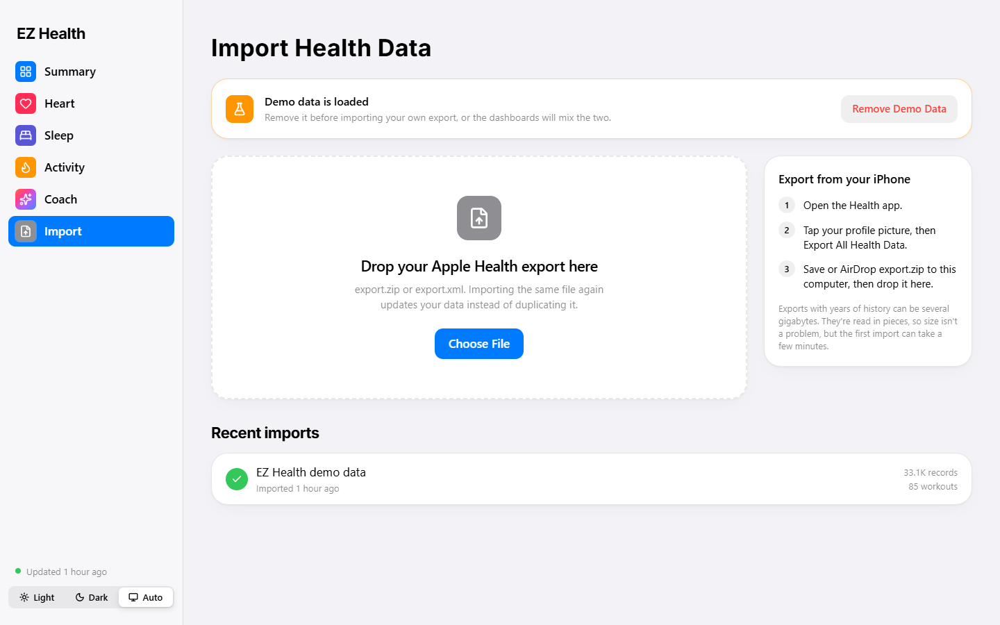
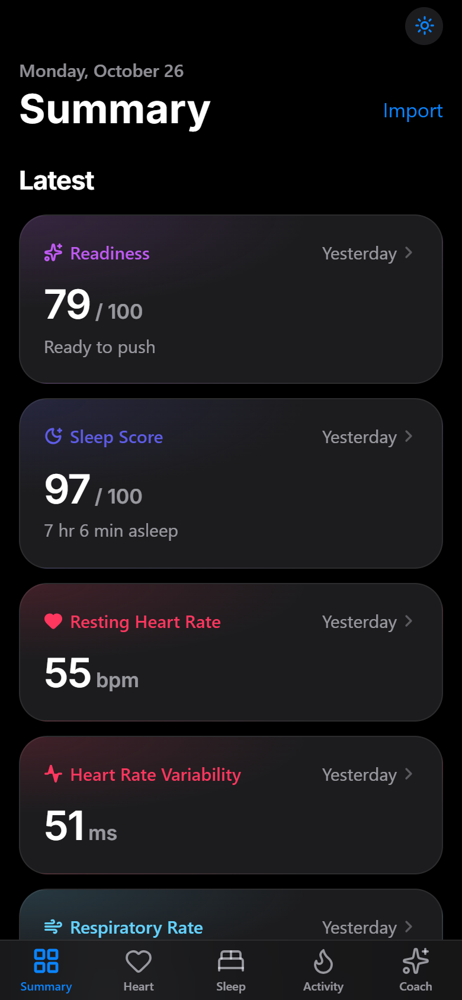
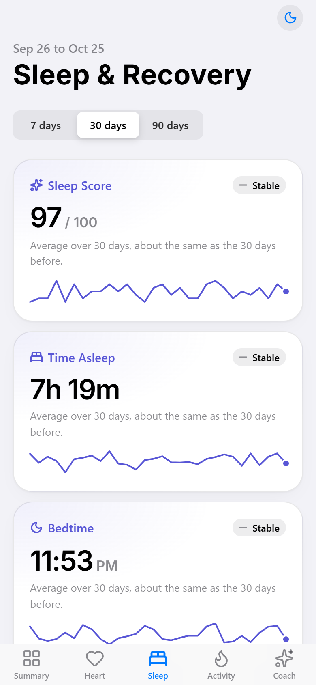
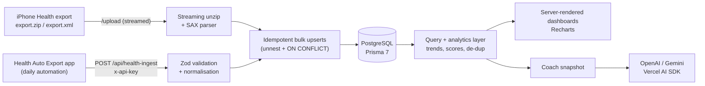

# EZ Health

**Apple Health analytics with an AI training coach.** Import your iPhone's full Health export (or stream it daily from an iOS automation) and get iOS-style dashboards for heart rate, HRV, sleep stages, activity patterns and workouts, plus a coach that plans running and strength sessions from your actual recovery data.

    

**Live demo: [ez-health-six.vercel.app](https://ez-health-six.vercel.app)** (generated demo data; the AI chat is switched off on the public demo)



> Screenshots use the built-in generated demo data (`npm run demo:import`), not real health records.

## Highlights

- **Multi-gigabyte imports with flat memory.** `export.zip` is unzipped and parsed as a stream (SAX), never loaded whole. A 1.38M-record export imports in about 58 s while memory stays around 32 MB (it was 678 MB before source strings were interned).
- **Idempotent bulk writes.** Upserts use Postgres `unnest()` + `ON CONFLICT`, thousands of rows per statement, so re-importing the same file or re-sent webhook windows update data instead of duplicating it.
- **Timezone-correct analytics.** Every sample keeps its original UTC offset, plus precomputed local date, hour and weekday. "Most active hour" and "bedtime" mean the time on your clock, even across travel.
- **Multi-device de-duplication.** iPhone and Apple Watch both log the same activity. Data is stored per source and merged at query time, for example the best-measured night for sleep and the per-hour maximum for active energy.
- **Explainable scores.** Readiness, sleep score, consistency and the 7/30/90-day trend verdicts are deterministic functions with documented thresholds. A change only counts as a trend when it exceeds normal day-to-day variation.
- **Grounded, private AI coach.** The model receives a compact text summary computed by the same code as the charts, so the advice and the dashboards never disagree, and raw samples never leave the server. Provider-agnostic: OpenAI or Gemini.
- **Accessible charts.** Palettes are checked for color-vision deficiency and contrast in both themes, every chart has a "Show as table" view, and dark mode has its own validated colors rather than inverted ones.

## Screenshots

| Summary | Summary (dark) |
| --- | --- |
|  |  |
| **Heart & Breathing** | **AI Coach** |
|  |  |
| **Workouts & Trends** | **Import** |
|  |  |

<p align="center">
  
  &nbsp;&nbsp;
  
</p>

## Dashboards

| Page | What it shows |
| --- | --- |
| Summary | Readiness, sleep score and the latest reading of each metric |
| Heart & Breathing | Resting vs workout heart rate, HRV, respiratory rate; 7/30/90-day trend verdicts |
| Sleep & Recovery | Last night's stage timeline, bedtime/wake schedule, stages per night, sleep score, consistency |
| Workouts & Trends | Fitness & recovery trend evaluator (7/30/90 days), weekday × hour activity heatmap, side-by-side workout comparison |
| AI Coach | Rule-based readiness + a chat coach (OpenAI or Gemini via the Vercel AI SDK) |

All scores are documented where they're computed: `src/lib/analytics/` (`trend.ts`, `sleep.ts`, `readiness.ts`) and `src/lib/queries/evaluation.ts`. The coach's summary is built in `src/lib/coach/snapshot.ts`.

## Architecture



**Stack:** Next.js 15 (App Router, Server Components, route handlers), React 19, TypeScript, Tailwind CSS v4, Motion, Recharts, Lucide, Prisma 7 with the `pg` driver adapter, PostgreSQL (local Docker, Supabase or Prisma Postgres), zod, saxes, jszip, Vercel AI SDK.

## Run it locally

```bash
npm install                 # also runs `prisma generate`
cp .env.example .env        # then fill in DATABASE_URL + INGEST_API_KEY
docker compose up -d        # local Postgres (or point DATABASE_URL at Supabase / Prisma Postgres)
npm run db:migrate          # create tables
npm run demo:import         # optional: 120 days of realistic demo data to explore
npm run dev                 # http://localhost:3000
```

Other scripts: `npm run ingest:sample` posts `scripts/sample-payload.json` to the local webhook, and `npm run demo:clear` removes the demo data (also a button on `/upload`). Add `OPENAI_API_KEY` or `GOOGLE_GENERATIVE_AI_API_KEY` to enable the coach chat.

## Importing your full history (export.zip)

On iPhone: Health → profile picture → **Export All Health Data**, then drop `export.zip` (or `export.xml`) on **/upload**.

- The upload streams to a temp file and is parsed in the background with a SAX parser (`saxes`), so memory stays flat regardless of file size; the page shows live progress.
- Heart rate, respiratory rate and SpO2 are rolled into hourly min/avg/max buckets; active/basal energy, steps and exercise minutes into hourly totals (per source). Resting HR, HRV and VO2 max, sleep segments, workouts and Activity ring totals are stored as-is.
- Re-importing is safe: everything is upserted.
- For very large exports you can skip the browser: `npm run import:export -- path/to/export.zip`
- Uploads go through the Node server, so this needs a long-running server (local / self-hosted). Serverless hosts cap request bodies (Vercel: 4.5 MB); on Vercel, import with the CLI script above against the same database.

## Connecting Health Auto Export (iOS)

Automations → New → **REST API**
- URL: `https://<your-host>/api/health-ingest`
- Format: **JSON**, Export version **2** (v1 also accepted)
- Headers: `x-api-key: <INGEST_API_KEY>`
- Metrics: Heart Rate, Resting Heart Rate, Heart Rate Variability, Respiratory Rate, Active Energy, Sleep Analysis (+ optional Steps, Exercise Time, VO2 Max, Blood Oxygen)
- Include **Workouts**
- Time grouping: **Hours** (gives the most/least active hours heatmap its data)
- Sleep: either aggregated or unaggregated works; **unaggregated** additionally stores stage segments for the sleep timeline.

The endpoint is idempotent: re-sent windows overwrite existing samples rather than duplicating them.

## Deploying to Vercel with Prisma Postgres

1. Add the Prisma Postgres integration to the Vercel project. It sets `DATABASE_URL` (direct `postgres://` URL), which is what the app uses. No Accelerate extension is needed.
2. Create the tables once, from your machine, with the same URL: `DATABASE_URL="postgres://..." npm run db:deploy`. Re-run it after adding migrations.
3. Add `INGEST_API_KEY` and an AI key in Vercel's environment variables, then deploy. `npm run build` runs `prisma generate && next build`.

## Project layout

| Path | Purpose |
| --- | --- |
| `prisma/schema.prisma` | `MetricSample`, `SleepSession`, `SleepStage`, `Workout`, `DailyActivity`, `ImportJob`, `IngestLog` |
| `src/app/api/health-ingest/route.ts` | Webhook: auth, validation, logging |
| `src/lib/health-export/schema.ts` | Zod shapes of the HAE payload (v1 + v2) |
| `src/lib/health-export/normalize.ts` | Pure parsing: dates/timezones, units, sleep-night attribution |
| `src/lib/health-export/ingest.ts` | Webhook orchestration |
| `src/lib/health-export/store.ts` | Shared idempotent bulk writers (samples, sleep, workouts, daily activity) |
| `src/lib/apple-health/xml-parser.ts` | Streaming export.xml parser (pure, no I/O) |
| `src/lib/apple-health/import.ts` | ZIP/XML import job: unzip stream → parse → save, with progress |
| `src/app/api/upload-xml/` | Upload endpoint + job status for polling |
| `src/lib/analytics/` | Pure scoring and trend functions |
| `src/lib/queries/` | Per-dashboard data loading |
| `src/lib/coach/` | Coach snapshot and model selection |

## Limitations

**No authentication yet.** Anyone who can reach the server can view the dashboards, upload data and use the coach (and your AI key). Keep it on localhost or behind a private network until auth is added. The app is single-user by design, and its scores are informational, not medical advice.
